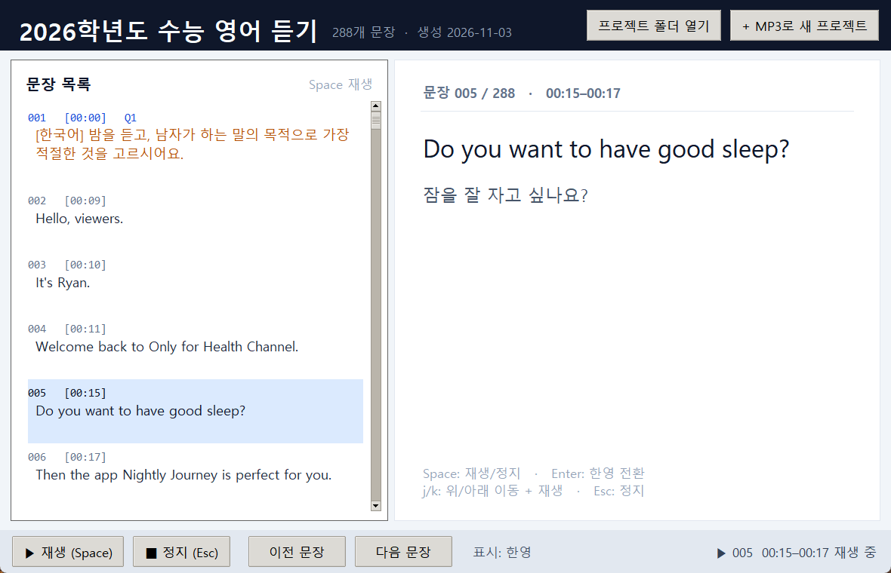
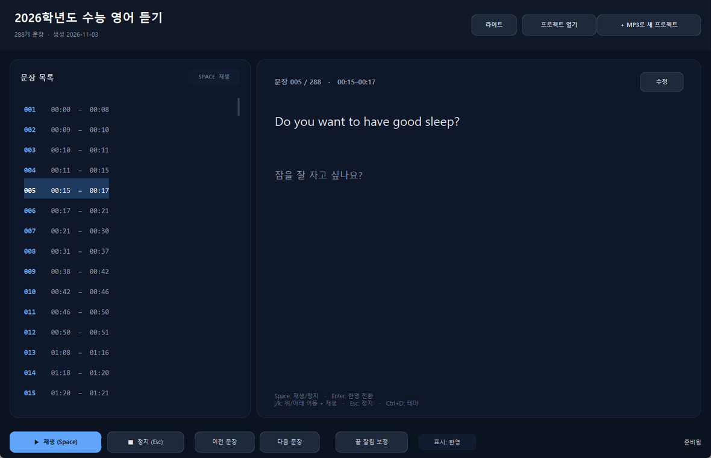
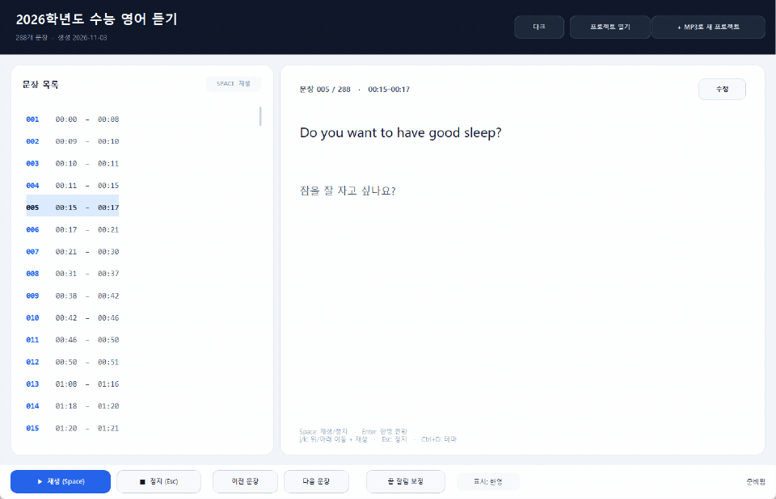

# mp3_study_app — 한영 자막 생성기

영어 음성(mp3/wav/m4a)을 **PyTorch Whisper**로 받아쓰고, 문장 단위로 끊어
**`[분:초] 영어 문장 / 한국어 번역`** 형태의 공부용 자막과, 문장별로 다시
들어볼 수 있는 **데스크톱 학습 GUI**를 만드는 앱입니다.

GPU가 없는 노트북(CPU only)을 기준으로 만들었습니다. `ffmpeg`는
`imageio-ffmpeg`에 포함된 바이너리를 쓰므로 따로 설치할 필요가 없습니다.



## 기능

- Whisper **CPU 추론** (기본 `small`, `base`/`medium` 선택 가능)
- 단어 타임스탬프 기반 **문장 단위 cue** 생성 (너무 긴 문장은 쉼표/단어 경계에서 분할)
- 영어 → 한국어 번역
  - `google`: CLI 기본값. 모델 다운로드/CPU 부담 없이 빠름 (온라인)
  - `nllb`: 완전 오프라인 PyTorch 번역. **GUI 기본값**, 최초 1회만 내려받고 이후 로컬 캐시 재사용
  - `none`: 영어만 출력
- 한국어 안내 방송 구간은 자동 감지해서 번역하지 않고 그대로 표시
- 출력 형식: **SRT, Markdown, TXT(공부용), CSV, JSON, VTT**
- ASR/번역 결과를 캐시해서 **재실행 시 이어서 작업**
- `[00:09]`처럼 **분:초 시작 시간** 표시
- **GUI**: 문장 목록에서 선택 후 `Space`로 재생, `Enter`로 한/영 전환, `j`/`k`로 이동+재생
- **GUI에서 MP3를 골라 새 프로젝트 생성** (진행률 창 + 취소)
- **끝 잘림 일괄 보정**: 종료 직후에 아주 짧게 남은 음성을 감지해 cue 종료 시간을 늘리고, 경계가 겹치면 다음 시작도 안전하게 이동하며, 바뀐 문장 번호를 보고

## 설치

Python 3.10~3.12를 권장합니다. (Whisper가 의존하는 numba 때문에 3.13은 아직 불안정할 수 있습니다.)

```powershell
cd C:\Users\fall2\work\mp3_study_app

# 가상환경 (선택)
python -m venv .venv
.\.venv\Scripts\Activate.ps1

# CPU 전용 PyTorch (Windows는 기본 wheel이 CPU입니다)
python -m pip install --upgrade pip
python -m pip install torch --index-url https://download.pytorch.org/whl/cpu
python -m pip install -r requirements.txt
```

Linux에서 CUDA 없는 CPU만 쓴다면 위 `torch` 설치 명령을 그대로 쓰면 됩니다.
이미 CUDA용 torch가 설치되어 있어도 `--device cpu`로 실행할 수 있습니다.

첫 실행 때 Whisper 모델을 내려받습니다. GUI의 NLLB 번역도 최초 1회
`facebook/nllb-200-distilled-600M`(약 2.4GB)을 내려받은 뒤 로컬 캐시를
계속 사용합니다. Tkinter는 Windows/macOS의 python.org 배포판에 포함되어
있습니다(Linux는 `sudo apt install python3-tk`).

| 모델 | 대략 크기 | 메모리 | 22분 오디오 기준 CPU 시간* |
|---|---:|---:|---:|
| `base` | 140 MB | ~1 GB | 약 7~9분 |
| `small` (기본) | 460 MB | ~2 GB | 약 15~20분 |
| `medium` | 1.5 GB | ~5 GB | 약 30~45분 |

\* 16스레드 노트북 CPU, `--beam-size 1` 기준 대략적인 값입니다. 코어 수에 따라
달라집니다. `small`은 `base`보다 고유명사/문장부호가 조금 더 정확합니다.
`--beam-size`를 5로 올리면 품질은 조금 좋아지지만 2~4배 느려집니다.
노트북이 느리다면 `--model base`를 먼저 사용해 보세요.

## GUI로 공부하기

```powershell
python gui.py
```

- 왼쪽: **문장 번호 + 시작/종료 시간** 목록 (`005  00:15 - 00:17`)
  - 영어 본문은 목록에 표시하지 않아 듣기 학습을 방해하지 않습니다.
- 오른쪽: 선택한 문장의 영어/한국어 본문과 전체 문장
- 상단 **`+ MP3로 새 프로젝트`**: MP3를 고르고 이름/Whisper 모델을 정하면
  `data/project/<파일명>/`에 프로젝트를 만들고, 진행률 창에 단계/퍼센트를
  표시합니다. NLLB 번역은 고정이며 Google 번역은 사용하지 않습니다.
- **라이트/다크 테마**: 상단 `다크`/`라이트` 버튼 또는 `Ctrl+D`로 즉시 전환
- 하단 **`끝 잘림 보정`**: 프로젝트의 모든 문장을 한 번에 분석해, 종료
  직후에 음성이 아주 조금 더 이어지는 문장만 **0.05~0.70초** 종료 시간을
  늘립니다. 바뀐 문장 번호와 `이전 → 새` 종료 시간을 결과 창에 보여 주고,
  cue JSON과 기존 `srt`/`vtt`/`txt`/`md`/`csv`를 함께 다시 저장합니다.
  다음 문장 시작과 경계가 정확히 겹치는 문장은, 그 뒤에 충분한 무음이
  있을 때만 다음 문장 시작도 함께 뒤로 옮깁니다.

| 키 | 동작 |
|---|---|
| `↑` / `↓` | 문장 선택 이동 |
| `Space` | 선택한 문장 재생 / 정지 |
| `Enter` | 오른쪽 본문의 한/영 표시 전환 |
| `j` | 아래로 이동하며 바로 재생 |
| `k` | 위로 이동하며 바로 재생 |
| `Ctrl+D` | 라이트/다크 테마 전환 |
| `Esc` | 재생 정지 |

> `j`는 아래, `k`는 위입니다(Vim과 동일). 목록 이동과 동시에 해당 문장이
> 재생됩니다. 문장 끝이 잘리지 않도록 앞뒤로 약간의 여유를 두고 재생합니다.

> **`끝 잘림 보정`**은 저장된 **cue 종료 시간**을 늘리는 기능입니다. MP3
> 파일 자체를 다시 인코딩하지 않습니다. 다음 문장의 시작은 침범하지 않고,
> 끝이 무음이거나 0.7초보다 길게 이어지는 구간은 잘못 붙이지 않도록
> 건드리지 않습니다. 다만 다음 문장 시작이 현재 종료와 **정확히 같고**
> 그 사이에 0.1초 이상의 무음이 확인되면, 다음 문장의 실제 발화를 침범하지
> 않는 선에서 두 문장의 경계를 함께 뒤로 옮깁니다. 재생도 저장된 종료
> 시간보다 먼저 끊기지 않도록 짧은 꼬리를 항상 포함합니다.

다크 테마로 바로 시작하려면:

```powershell
python gui.py --theme dark
```

<details>
<summary>다크 테마 미리보기</summary>



</details>

`+ MP3로 새 프로젝트`는 오디오를 프로젝트 폴더로 복사한 뒤 Whisper 모델을
내려받아 인식합니다. CPU에서 22분 음원 기준 `small`은 대략 15~20분,
`base`는 7~9분 걸립니다. 창의 **취소**는 현재 단계(음성 인식/번역)가 끝난
뒤 적용되며, 이미 끝난 인식 결과는 캐시에 남아 다시 만들 때 재사용됩니다.

NLLB 모델은 최초 1회만 `~/.cache/huggingface`에 내려받고(약 2.4GB),
이후에는 네트워크 확인 없이 로컬 캐시만 사용합니다.

## CLI로 자막 만들기

가장 기본:

```powershell
python main.py data/project/ksat_2026_english/ksat_2026_english.mp3 `
  --out-dir data/project/ksat_2026_english
```

빠르게 초안만 보고 싶을 때:

```powershell
python main.py data/lecture.mp3 --model base --formats srt,txt
```

번역 없이 영어 자막만:

```powershell
python main.py data/lecture.mp3 --translator none --formats srt
```

완전 오프라인 번역(NLLB):

```powershell
python main.py data/lecture.mp3 --translator nllb
```

출력 폴더/형식 지정:

```powershell
python main.py data/lecture.mp3 `
  --out-dir output `
  --formats srt,md,txt,csv,json
```

생성 결과를 프로젝트 폴더로 모으고 `project.json` 만들기:

```powershell
python make_project.py `
  --name "2026학년도 수능 영어 듣기" `
  --audio data/lecture.mp3 `
  --out-dir output
```

`--project-dir`를 생략하면 `data/project/<음원 파일명>/`에 만들어집니다.
생성일은 `--created-at`으로 고정할 수 있고, 생략하면 현재 시각입니다.
같은 프로젝트에 다시 실행해 메타데이터만 갱신해도 기존 `created_at`은
유지됩니다.

### 주요 옵션

| 옵션 | 설명 |
|---|---|
| `--model` | `tiny`, `base`, `small`(기본), `medium`, `large-v3` |
| `--language` | 기본 `en`. `auto`는 자동 감지(한국어 안내가 많은 파일에서는 비권장) |
| `--device` | `auto`(기본), `cpu`, `cuda`, `mps` |
| `--threads` | PyTorch CPU 스레드 수 (0 = 논리 코어 전체) |
| `--beam-size` | Whisper beam search 크기 (기본 1, 빠름) |
| `--translator` | `google`(기본), `nllb`, `none` |
| `--translate-workers` | Google 번역 동시 요청 수 (기본 3) |
| `--max-cue-seconds` | cue 최대 길이(초), 기본 12 |
| `--max-cue-chars` | cue 최대 글자 수, 기본 180 |
| `--formats` | `srt,vtt,txt,md,csv,json` 조합 |
| `--srt-mode` | `bilingual`(기본), `english`, `korean` |
| `--force-asr` | ASR 캐시 무시 |
| `--force-translate` | 번역 캐시 무시 |
| `--quiet` | 진행 로그 최소화 |

## 출력 예시

`data/project/ksat_2026_english/ksat_2026_english.txt`:

```text
제목: 2026학년도 수능 영어 듣기
원본: C:\Users\fall2\work\mp3_study_app\data\project\ksat_2026_english\ksat_2026_english.mp3
모델: whisper-small (cpu)
번역: google
길이: 22:36
생성: 2026-11-02 23:10:00
========================================================================

--- 1번 ---

[00:00] (한국어) 다음을 듣고, 남자가 하는 말의 목적으로 가장 적절한 것을 고르시오.

[00:09] Hello, viewers. It's Ryan.
          안녕하세요, 시청자 여러분. 라이언입니다.

[00:15] Do you want to have good sleep?
          잠을 잘 자고 싶나요?

[00:17] Then, the app Nightly Journey is perfect for you.
          그렇다면 Nightly Journey 앱이 당신에게 딱 맞습니다.
```

`data/project/ksat_2026_english/ksat_2026_english.srt`:

```srt
1
00:00:09,340 --> 00:00:10,750
Hello, viewers.
안녕하세요, 시청자 여러분.

2
00:00:10,800 --> 00:00:11,930
It's Ryan.
라이언입니다.
```

Markdown(`.md`)은 `**[00:09]** 영어` + 인용문 형태의 한국어로,
CSV는 Excel에서 바로 열 수 있도록 UTF-8 BOM으로 저장합니다.

생성된 `.srt`를 음원과 같은 이름으로 같은 폴더에 두면 VLC/PotPlayer 같은
플레이어가 자막을 자동으로 불러옵니다. (프로젝트 폴더에는 이미 함께 있습니다.)

## 프로젝트 폴더와 project.json

GUI와 `make_project.py`는 음원과 생성 파일을 `data/project/<이름>/` 하나에
모읍니다.

```text
data/project/ksat_2026_english/
  project.json              # 이름, 생성일, 파일 목록, cue 수
  ksat_2026_english.mp3
  ksat_2026_english.srt
  ksat_2026_english.vtt
  ksat_2026_english.txt
  ksat_2026_english.md
  ksat_2026_english.csv
  ksat_2026_english.json
  .cache/                   # Whisper/번역 캐시
```

`project.json` 예:

```json
{
  "schema_version": 1,
  "name": "2026학년도 수능 영어 듣기",
  "slug": "ksat_2026_english",
  "created_at": "2026-11-03T10:12:00+09:00",
  "audio": "ksat_2026_english.mp3",
  "cues": "ksat_2026_english.json",
  "subtitles": {"srt": "ksat_2026_english.srt", "txt": "..."},
  "cue_count": 288,
  "duration": 1356.3,
  "meta": {"model": "small", "translator": "google", "language": "en"}
}
```

## 캐시와 재실행

```text
data/project/ksat_2026_english/
  .cache/
    ksat_2026_english.small.en.asr.json   # Whisper 결과
    ksat_2026_english.google.ko.json      # 문장별 번역 결과
```

ASR은 모델/언어/파일 크기/mtime이 같으면 건너뜁니다. 번역은 문장 해시
기준으로 캐시하므로, 중간에 실패해도 다시 실행하면 성공한 문장은
재사용합니다. `--force-asr`, `--force-translate`로 캐시를 무시할 수 있습니다.
GUI의 새 프로젝트는 새 폴더를 만들고, 취소/실패로 남은 폴더는 다음 시도에서
같은 폴더를 재사용해 이미 끝난 음성 인식 결과를 건너뜁니다.

## 한국어 안내 구간 처리

수능 영어 듣기처럼 한국어 안내와 영어 대화가 섞인 파일은 다음처럼
동작합니다.

1. Whisper가 한국어 구간을 한국어로 받아쓰면, 한글 비율로 한국어 cue를 감지
2. 해당 cue는 번역하지 않고 `(한국어)`로 표시
3. 영어 cue만 한국어로 번역

한국어 안내 문장은 Whisper 한국어 인식 품질에 영향을 받을 수 있습니다.
특히 `2번`과 `이번`처럼 발음이 같은 문제 번호는 숫자 대신 다른 단어로
받아쓰일 수 있어서, `--- N번 ---` 구분이 일부 빠질 수 있습니다.
`data/`에 있는 공식 대본 PDF와 대조하면 좋습니다. (이 앱은 PDF를 자동으로
읽지 않습니다.)

Whisper가 30초 창 앞쪽의 긴 무음에 걸려 뒤쪽 안내를 통째로 건너뛰는
경우가 있어, 문장 사이의 긴 무음 구간은 에너지 기반 VAD로 말소리를 찾아
한 번 더 인식합니다. 또 12초가 넘는데 단어가 거의 없는 영어 구간(한국어
안내를 영어 문장 하나로 덮어쓴 경우)은 말소리 구간만 한국어로 다시 읽어
복구합니다. 이 보정은 캐시 fingerprint에 포함되어 있어 로직이 바뀌면
자동으로 다시 인식합니다.

## 번역 방식 선택

### Google (CLI 기본)

- 장점: 모델 다운로드 없음, CPU 부담 없음, 품질 좋음, 빠름
- 단점: 인터넷 필요, 문장이 Google로 전송됨
- **GUI에서는 사용하지 않습니다.**
- Google의 공개 웹 엔드포인트를 사용하므로 예고 없이 동작이 바뀔 수 있습니다.
- 429/네트워크 오류가 나면 `--translate-workers 1`로 줄이고 다시 실행하세요.

### NLLB (오프라인, GUI 기본)

```powershell
python main.py data/lecture.mp3 --translator nllb
```

- `facebook/nllb-200-distilled-600M` 사용 (약 2.4GB, 최초 1회만 다운로드)
- CPU에서 Google보다 느립니다. 노트북에서는 `--device cpu`(기본)로 동작합니다.
- 두 번째 실행부터는 `local_files_only`로 로컬 캐시만 읽어 네트워크 없이
  바로 시작합니다.
- GUI는 항상 NLLB를 사용합니다.

### 번역 없음

```powershell
python main.py data/lecture.mp3 --translator none
```

## 테스트

모델 다운로드 없이 문장 분리/타임스탬프/출력/프로젝트/무음 구간 보정
로직을 검사합니다.

```powershell
python -m unittest discover -s tests -v
```

## 문제 해결

**`ffmpeg`를 찾을 수 없습니다**
`pip install imageio-ffmpeg`가 설치되어 있는지 확인하세요. 이 앱은 번들
ffmpeg를 우선 사용합니다.

**Whisper 모델 다운로드가 실패합니다**
`~/.cache/whisper`(Windows: `C:\Users\<사용자>\.cache\whisper`)에 모델이
내려받아집니다. 사내망/방화벽이면 프록시 설정이 필요합니다. `--model base`로
작은 모델을 먼저 시도해 보세요.

**메모리가 부족합니다**
`--model base` 또는 `--model tiny`를 쓰세요. `medium`은 16GB 노트북에서도
다른 앱을 많이 켜 두면 부족할 수 있습니다.

**번역이 일부 비어 있습니다**
Google 요청 한도일 수 있습니다. `--translate-workers 1`로 다시 실행하면
캐시된 문장은 건너뛰고 실패한 문장만 재시도합니다.

**GUI에서 소리가 나지 않습니다**
`pygame`이 설치되어 있는지 확인하세요(`pip install -r requirements.txt`).
스피커/헤드폰 기본 출력 장치를 사용합니다.

**NLLB 모델 다운로드가 실패합니다**
최초 1회는 `~/.cache/huggingface`로 약 2.4GB를 내려받으므로 인터넷이
필요합니다. 한 번 받은 뒤에는 로컬 캐시만 사용합니다. 사내망이면
`HF_ENDPOINT`/프록시 설정이 필요할 수 있습니다.

**GUI에 프로젝트 목록이 비어 있습니다**
프로젝트가 없어도 GUI는 실행됩니다. 오른쪽 위
`+ MP3로 새 프로젝트`를 누르거나, `python gui.py --project
data/project/<이름>`처럼 폴더를 직접 지정하세요.

**한국어가 깨져 보입니다**
출력 파일은 UTF-8입니다. Windows 콘솔 미리보기는 UTF-8로 재설정되지만,
`.srt`/`.csv`를 메모장이나 Excel에서 열 때 인코딩을 UTF-8로 선택하세요.
CSV는 Excel 호환을 위해 UTF-8 BOM으로 저장합니다.

## 프로젝트 구조

```text
main.py                     # CLI 진입점
gui.py                      # GUI 진입점 (python gui.py)
make_project.py             # 음원/결과를 프로젝트 폴더로 모으고 project.json 생성
src/study_subs/
  audio.py                  # 번들 ffmpeg로 16kHz 모노 디코딩
  asr.py                    # PyTorch Whisper 전사 + 무음 구간 재인식
  sentences.py              # 단어 타임스탬프 → 문장 cue
  translate.py              # Google / NLLB 번역 + 캐시
  subtitles.py              # SRT/VTT/TXT/MD/CSV/JSON 출력
  pipeline.py               # 전체 파이프라인 + ASR 캐시 + 진행률
  project.py                # 프로젝트 폴더/project.json 관리
  gui.py                    # Tkinter 학습 GUI
  cli.py                    # argparse
tests/test_core.py          # 모델 없이 실행 가능한 단위 테스트
data/project/<이름>/        # 음원 + 자막 + 캐시 + project.json
```

## 저작권

`data/`의 수능 영어 듣기 음원과 대본 PDF는 한국교육과정평가원의
저작물입니다. 개인 학습용으로만 사용하고 재배포하지 마세요.

## 데모

20초짜리 실제 사용 흐름입니다. 문장 이동(`j`/`k`), 재생(`Space`),
한/영 전환(`Enter`), 라이트/다크 전환(`Ctrl+D`)을 순서대로 보여 줍니다.


